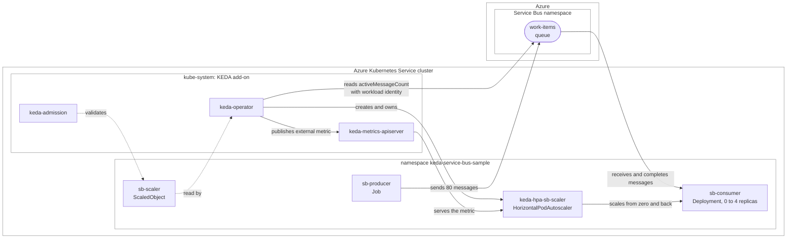

## Autoscale on an Azure Service Bus queue with the AKS KEDA add-on

[Kubernetes Event-driven Autoscaling (KEDA)](https://keda.sh/) scales a workload on the size of the work waiting for it, instead of on CPU or memory. On [Azure Kubernetes Service (AKS)](https://learn.microsoft.com/en-us/azure/aks/what-is-aks) it is available as a [managed add-on](https://learn.microsoft.com/en-us/azure/aks/keda-about): AKS installs and maintains the KEDA operator, metrics API server and admission webhooks in the `kube-system` namespace when the cluster is created or updated with `--enable-keda`.

This tutorial deploys a Python consumer that reads from an [Azure Service Bus](https://learn.microsoft.com/en-us/azure/service-bus-messaging/service-bus-messaging-overview) queue and a Python producer that fills it. KEDA scales the consumer from **zero replicas** up to four and back to zero as the queue fills and drains. This standalone repository targets Azure. Emulator compatibility is retained from the upstream sample.

The KEDA operator authenticates to Azure with [Microsoft Entra Workload ID](https://learn.microsoft.com/en-us/azure/aks/workload-identity-overview), following the [KEDA and workload identity tutorial](https://learn.microsoft.com/en-us/azure/aks/keda-workload-identity): a user-assigned managed identity is federated to the `keda-operator` service account, granted the **Azure Service Bus Data Owner** role on the namespace, and referenced from a `TriggerAuthentication`. No secret is involved in the scaling decision.

On public Azure, both applications use `WorkloadIdentityCredential` with the `sb-app` service account. This account is federated to the shared managed identity and uses its existing namespace-scoped data role. The deployment script sets `SERVICEBUS_FULLY_QUALIFIED_NAMESPACE` from the Azure endpoint. It does not retrieve or mount a connection string. Service Bus local authentication can remain disabled.

On the emulator, the applications still use the namespace connection string. Its plain-TCP AMQP listener does not support Microsoft Entra authentication. The scaler uses workload identity on both targets. If workload identity fails on Azure, the applications do not fall back to a connection string.

> **Running on LocalStack?** Install the [lstk CLI](https://docs.localstack.cloud/aws/developer-tools/running-localstack/lstk/) and run `lstk az start-interception` to route Azure CLI calls to the emulator. See [Run against LocalStack](../../../README.md#run-against-localstack) for the full setup.

## Architecture

The producer and the consumer are two workloads in the same Kubernetes namespace inside the AKS cluster. The producer fills the Service Bus queue, the consumer drains it, and the KEDA add-on in `kube-system` reads the queue's depth to decide how many consumer replicas should exist.



## Prerequisites

- An AKS cluster and container registry. Use the Azure-only [00-provision-aks.sh](scripts/00-provision-aks.sh) below to create the sample prerequisites. For an existing cluster, match the values in [../00-variables.sh](../00-variables.sh) (cluster `local-aks-test`, resource group `local-rg`, registry `akskeda2194b8`, location `CanadaCentral`).
- [Azure CLI](https://learn.microsoft.com/en-us/cli/azure/install-azure-cli) (`az`), authenticated with `az login`. Running against LocalStack? Point the CLI at the emulator first, then run the same scripts unchanged.
- [kubectl](https://kubernetes.io/docs/tasks/tools/) and [Docker](https://docs.docker.com/get-docker/) to build and push the two images.
- [yq](https://github.com/mikefarah/yq), used to fill the manifests in with the values from `00-variables.sh`.
- Bash, `ssh-keygen`, and [kubelogin](https://azure.github.io/kubelogin/). On Windows, use Git Bash with the Windows tools available in `PATH`.

### Provision Azure prerequisites

This step creates billable Azure resources. Skip it if the required cluster and registry already exist.

The sample provisioning script creates the resource group, a virtual network with separate system and user subnets, a cluster managed identity, a Basic container registry, and AKS. Both node pools use `Standard_D4ds_v5` Linux nodes. Each pool starts with one node and can scale from one to three. Networking uses Azure CNI Overlay with Cilium. AKS uses the region's default Kubernetes version, KEDA, OIDC, workload identity, and Entra authentication with Azure RBAC. Local cluster administrator credentials and registry administrator credentials are disabled.

The script grants the cluster identity Network Contributor on the virtual network, the kubelet identity AcrPull on the registry, and the selected Entra group AKS RBAC Cluster Admin on the cluster. It does not create Bastion, Key Vault, Log Analytics, or diagnostic settings. AKS can still create load balancers and public IPs for outbound connectivity.

1. Select the intended subscription with `az account set --subscription "<approved-subscription-id>"`.
2. Register the required resource providers before provisioning: `Microsoft.ContainerService`, `Microsoft.ContainerRegistry`, `Microsoft.Network`, `Microsoft.Compute`, `Microsoft.ManagedIdentity`, and `Microsoft.ServiceBus`.
3. Set the following values in Bash:

```bash
export EXPECTED_SUBSCRIPTION_ID="<approved-subscription-id>"
export AKS_ADMIN_GROUP_OBJECT_ID="<approved-security-group-object-id>"
export AKS_SSH_PUBLIC_KEY="$HOME/.ssh/id_rsa_aks_sample.pub"
```

4. Change to `tutorials/keda/service-bus/scripts` from the repository root.
5. Run `bash ./00-provision-aks.sh`.

The script rejects a different active subscription or a non-public Azure Resource Manager endpoint. It stops on errors and leaves created resources in place for inspection. It reuses named resources on subsequent runs and rejects a cluster or user pool whose checked settings do not match. Review existing resources before reusing them. Existing resources are not relocated by a location change. Azure RBAC grants can take time to propagate.

The script does not merge cluster credentials into kubeconfig. Run `01-enable-keda.sh` next to select the new cluster. The provisioning script already enables KEDA, OIDC, and workload identity. On an existing cluster, OIDC and workload identity must also be enabled before running `02-create-managed-identity.sh`.

To check the provisioning logic without accessing Azure, run `bash ./service-bus/tests/provision-aks.sh` from `tutorials/keda`. The test replaces Azure CLI calls with local responses. It does not prove that a live deployment will succeed.

## How to run it

After the prerequisites are ready, run scripts `01` through `08` in order. Each one sources [00-variables.sh](scripts/00-variables.sh). The producer script sends a new batch of messages each time it runs.

| Script | What it does | Expected result |
| --- | --- | --- |
| `00-variables.sh` | Variables for this tutorial (Service Bus namespace and queue, role, image names, Kubernetes object names). Sources the shared [../00-variables.sh](../00-variables.sh). Sourced by every script, never run directly. | Variables set. |
| `01-enable-keda.sh` | Verifies the cluster exists, enables the KEDA add-on if it is not enabled yet, merges the cluster credentials into `kubeconfig` (the only script that does, so run it first), and waits for the `scaledobjects.keda.sh` CRD. | The CRD is `Established` and the installed KEDA version is printed. |
| `02-create-managed-identity.sh` | Creates (or reuses) the managed identity and federates it to the KEDA operator and `system:serviceaccount:keda-service-bus-sample:sb-app`. Binds the operator to the identity. | Both federated credentials exist. The operator restart is skipped when its annotation is already correct. |
| `03-create-resources.sh` | Creates (or reuses) the Service Bus namespace and the `work-items` queue, then grants the identity the **Azure Service Bus Data Owner** role on the namespace, on its principal (object) id. | The namespace, the queue and the role assignment exist. |
| `04-build-docker-images.sh` | Builds the producer and consumer images from [src/producer](src/producer) and [src/consumer](src/consumer), each of which has its own `Dockerfile`. | Two local images tagged `v1`. |
| `05-push-docker-images.sh` | Logs into the registry, reads its login server, then tags and pushes both images. | Both images are in `akskeda2194b8`. |
| `06-deploy-consumer.sh` | Creates the namespace, application service account and config map. Creates a connection-string secret only for the emulator. Applies the consumer at zero replicas and the KEDA resources. | KEDA creates `keda-hpa-sb-scaler`. The consumer uses workload identity on Azure. |
| `07-run-producer.sh` | Deletes any previous producer `Job`, then runs it to send 80 messages and waits for it to complete. | The Job completes. Consumers can start processing as soon as messages arrive. |
| `08-watch-scaling.sh` | Asserts the behaviour: KEDA owns the workload, the consumer scales out from zero to at least two ready replicas, the queue drains, and the consumer scales back to zero. | `PASS` for each check and a final `SUCCESS` line. On failure it dumps the operator log, the `ScaledObject`, the autoscaler and the events. |
| `09-cleanup.sh` | Deletes the tutorial namespace. With `--disable-keda` it also turns the add-on off on the cluster. | The namespace is gone; the shared identity and the operator binding are left for the other tutorials. |

```bash
cd tutorials/keda/service-bus/scripts
./01-enable-keda.sh
./02-create-managed-identity.sh
./03-create-resources.sh
./04-build-docker-images.sh
./05-push-docker-images.sh
./06-deploy-consumer.sh
./07-run-producer.sh
./08-watch-scaling.sh
# ./09-cleanup.sh                 # when finished
# ./09-cleanup.sh --disable-keda   # also remove the KEDA add-on
```

### Kubernetes manifests

Every manifest in [scripts/](scripts/) is valid, applyable YAML whose environment-specific fields are empty strings or placeholders; the deploy scripts fill them in with `yq`, which is why the same files work against the emulator and against Azure without edits.

| Manifest | What it creates | Filled in at apply time |
| --- | --- | --- |
| `namespace.yml` | The `keda-service-bus-sample` namespace that holds everything else. | The namespace name. |
| `configmap.yml` | `sb-app-config`, the non-secret settings both applications read as environment variables. | The queue name, the message count, the seconds of work per message and the batch size. |
| `serviceaccount.yml` | `sb-app`, the application service account. | The managed identity client ID and tenant ID. |
| `secret.yml` | `sb-connection`, used only by the emulator. | The emulator connection string, base64 encoded. Azure deployments do not create or mount this Secret. |
| `deployment.yml` | `sb-consumer`, the workload KEDA scales, at `replicas: 0`. | The consumer image, service account, pull policy and configuration references. The Azure pod has the workload-identity label and no Secret reference. |
| `triggerauthentication.yml` | `sb-trigger-auth`, which tells KEDA to authenticate as the shared managed identity with workload identity. | The managed identity's client id. |
| `scaledobject.yml` | `sb-scaler`, the trigger and the scaling bounds. KEDA turns it into the `keda-hpa-sb-scaler` autoscaler. | The queue and namespace names, the message-count threshold, the derived `endpointSuffix`, and the polling, cooldown and replica bounds. |
| `producer-job.yml` | `sb-producer`, the `Job` that fills the queue. | The producer image, service account, pull policy and configuration references. Azure uses the same workload-identity binding as the consumer. |

### Applications

The producer and the consumer are separate Python applications with their own dependencies and their own image, built from `src/` and pushed to the registry attached to the cluster.

Both Docker builds install Python dependencies from `https://packagefeedproxy.microsoft.io/pypi/simple`. If a dependency is unavailable, stop the build. Do not switch to a public package registry.

The build script targets `linux/amd64` to match the `Standard_D4ds_v5` AKS nodes. On an ARM64 host, Docker must support AMD64 emulation. If you use ARM64 AKS nodes, change the build platform to match them.

| Path | What it is |
| --- | --- |
| `src/producer/producer.py` | Sends `MESSAGE_COUNT` messages to the queue in batches with `ServiceBusClient`, logs its progress, and exits 0 so the `Job` completes. |
| `src/consumer/consumer.py` | Receives batches of `BATCH_SIZE`, spends `WORK_SECONDS` on each message and completes it. Deliberately resilient: a message whose lock is lost or whose AMQP link drops before it is settled is logged and skipped (Service Bus redelivers it), and a receiver failure reconnects rather than exiting, because a crash-looping consumer would burn the queue's `maxDeliveryCount` and dead-letter the backlog instead of processing it. |
| `src/{producer,consumer}/requirements.txt` | Pinned `azure-servicebus` and `azure-identity` dependencies, installed at image build time. |
| `src/{producer,consumer}/Dockerfile` | Two-stage build on `python:3.13-slim` that installs the dependencies into a virtual environment and runs as a non-root user. |

## How it works

**The scaling loop.** The `ScaledObject` names the consumer `Deployment` as its target and declares one `azure-servicebus` trigger with `messageCount: "5"`. The KEDA operator polls the queue's active message count every five seconds. While the queue is empty the Deployment stays at zero replicas. As soon as messages appear the operator activates it to one replica and publishes the count as an external metric, and the HorizontalPodAutoscaler that KEDA created (`keda-hpa-sb-scaler`) raises the replica count toward `ceil(messages / 5)`, capped at `maxReplicaCount: 4`. When the queue is empty again the autoscaler scales the Deployment back to zero after the `cooldownPeriod`.

The producer sends 80 messages and each consumer replica sleeps two seconds per message, so a single replica cannot drain the backlog before the autoscaler reacts. That is what makes the scale-out observable rather than a race.

To check the application authentication branches offline, run `python -m unittest discover -s service-bus/tests -p 'test_*.py'` from `tutorials/keda` with the sample dependencies installed. These tests cover Azure workload identity, emulator connection strings, and failure without credential fallback.

**Why the ramp is gradual.** Left to its defaults the autoscaler may add four replicas, or double the count, every fifteen seconds. With a backlog of `MESSAGE_COUNT` messages against a per-replica target of `SCALING_THRESHOLD`, the computed target is far above `MAX_REPLICAS`, so the default policy would jump straight to the cap in one step and there would be no ramp to watch. The `ScaledObject` therefore sets an explicit `scaleUp` policy of `SCALE_UP_PODS` replica per `SCALE_UP_PERIOD_SECONDS` seconds, so the scale-out is visible as `0 -> 1 -> 2 -> 3 -> 4`. Scale-in is left aggressive on purpose: once the backlog is gone there is nothing to be gradual about. Both knobs live in [../00-variables.sh](../00-variables.sh), and [08-watch-scaling.sh](scripts/08-watch-scaling.sh) records the observed steps and fails if the deployment reaches the cap in a single one.

**How the operator authenticates.** The identity is federated to the operator's service account, so the operator exchanges its projected service-account token for a Microsoft Entra token for that identity, and the **Azure Service Bus Data Owner** role assignment on the namespace is what authorizes the read. The role assignment is made on the identity's principal (object) id, never on its client id: the client id identifies the identity while it authenticates, the principal id is what Azure authorizes. The `TriggerAuthentication` carries the client id, and `kubectl rollout restart` is required after annotating the service account because the workload-identity variables are injected only when the pods start.

**Why the trigger carries `cloud: Private` and an `endpointSuffix`.** The scaler reads the message count over the HTTPS management API. On real Azure that API answers at `{namespace}.servicebus.windows.net:443`, and on the emulator it answers through the gateway. [06-deploy-consumer.sh](scripts/06-deploy-consumer.sh) therefore derives the suffix at apply time: the host comes from the ARM-returned `serviceBusEndpoint`, and the port comes from the ARM endpoint itself, because the management API is served on the same port as ARM while the `serviceBusEndpoint` port is the AMQP data port. A custom suffix is only accepted together with `cloud: Private`.

**Why the manifests contain empty values.** Every `.yml` in [scripts/](scripts/) is valid, applyable YAML whose environment-specific fields are empty strings or placeholders. The deploy scripts fill them in with `yq` from the values in `00-variables.sh` and from what Azure returns, which is why the same files work against the emulator and against Azure without edits.

## Resources

- [KEDA](https://keda.sh/) and the [Azure Service Bus scaler](https://keda.sh/docs/2.20/scalers/azure-service-bus/)
- [Simplified application autoscaling with the KEDA add-on on AKS](https://learn.microsoft.com/en-us/azure/aks/keda-about)
- [Install the KEDA add-on using the Azure CLI](https://learn.microsoft.com/en-us/azure/aks/keda-deploy-add-on-cli)
- [Securely scale your applications using the KEDA add-on and workload identity](https://learn.microsoft.com/en-us/azure/aks/keda-workload-identity)
- [Microsoft Entra Workload ID on AKS](https://learn.microsoft.com/en-us/azure/aks/workload-identity-overview)
- [Azure Service Bus queues](https://learn.microsoft.com/en-us/azure/service-bus-messaging/service-bus-queues-topics-subscriptions)
- [Kubernetes Jobs](https://kubernetes.io/docs/concepts/workloads/controllers/job/) and [HorizontalPodAutoscaler](https://kubernetes.io/docs/tasks/run-application/horizontal-pod-autoscale/)
- [LocalStack for Azure](https://docs.localstack.cloud/azure/)
